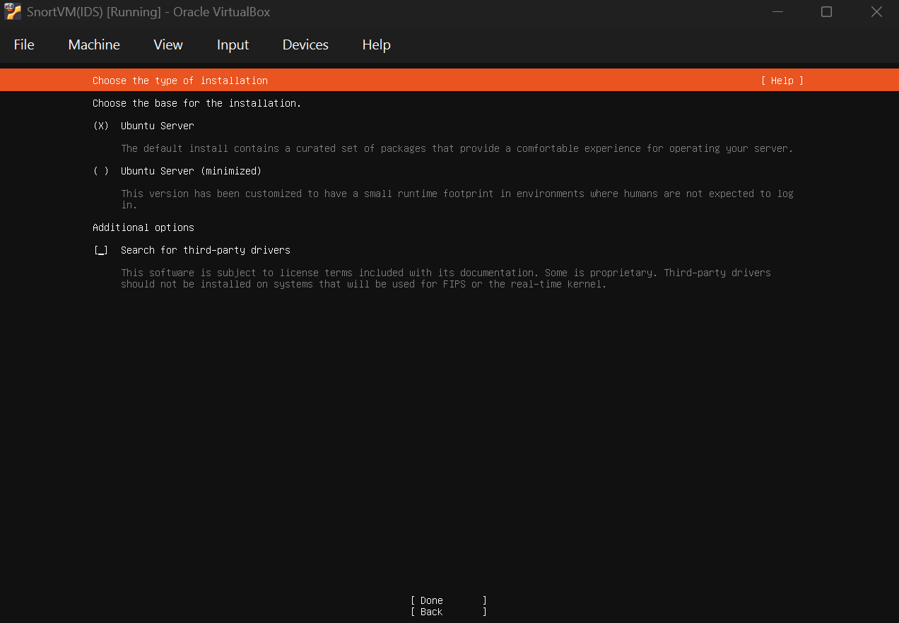
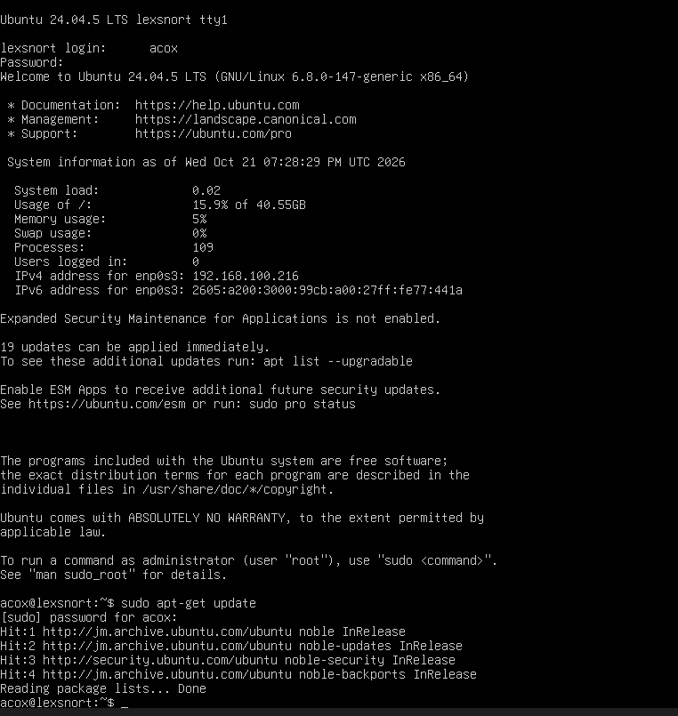
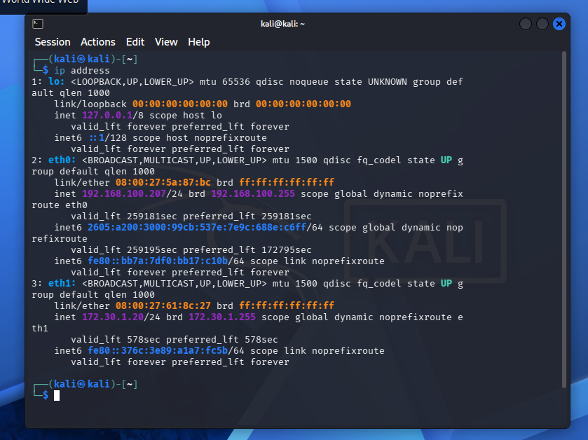
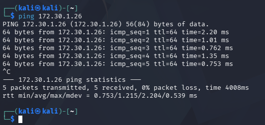
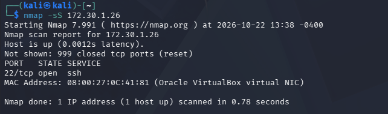

# Snort Intrusion Detection | Network Monitoring & Alert Analysis

[](https://www.snort.org/) [](https://ubuntu.com/) [](https://www.kali.org/) [](https://www.virtualbox.org/) [](https://nmap.org/)

**Documented by:** Alexander Cox  
**Project type:** Controlled cybersecurity home-lab exercise  
**Focus:** Network intrusion detection, ICMP monitoring, Snort configuration validation, alert interpretation, and service reconnaissance.

> **Evidence standard:** All screenshots come from `Cyber Home Lab Doc 1.docx`. The steps below distinguish *documented commands/results* from *suggested follow-up checks*. This lab demonstrates **Snort detection and alert visibility**, not verified traffic blocking.

## 1. Project overview

I prepared a Linux virtual machine for Snort-based network monitoring and used Kali Linux to generate and investigate network activity. I validated that the Snort configuration loaded successfully, ran the IDS against a specified network interface, and examined alerts produced for ICMP traffic between test hosts. A separate Nmap TCP SYN scan checked which services were reachable on the lab endpoint.

The goal was to develop hands-on understanding of **how a signature-based network IDS processes traffic, generates alerts, and supports an analyst's investigation**.

### Objectives

- Prepare an Ubuntu-based Snort VM in Oracle VirtualBox.
- Identify the host and lab-facing network interfaces.
- Verify connectivity before monitoring traffic.
- Validate Snort configuration and rule loading.
- Run Snort in live console-alert mode.
- Interpret alert timestamps, signatures, priority, and source/destination IPs.
- Understand basic saved-log inspection and Nmap validation.

### Tools and their roles

| Tool | Lab purpose |
|---|---|
| Oracle VirtualBox | Host the Linux VMs and configure virtual adapters. |
| Ubuntu Server / SnortVM | Run the Snort IDS sensor. |
| Snort 2.9.20 | Load IDS configuration/rules and report matching traffic. |
| Kali Linux | Generate ICMP traffic and run authorized scans. |
| `ip address` | View active interfaces and assigned IP addresses. |
| `ping` | Confirm ICMP reachability and create monitored traffic. |
| Nmap | Identify the reachable TCP service on a controlled endpoint. |

---

## 2. Lab layout and IP addressing

The source screenshots were captured during **different configuration stages**. This is a *logical* overview of the evidenced hosts, not a claim that every address was simultaneously active or every network was bridged together.

```text
                         Windows host PC
                               |
                         Oracle VirtualBox
                               |
                    Virtualized lab environment
                               |
             +-----------------+------------------+
             |                                    |
        Kali Linux                          Ubuntu / SnortVM
        -----------                         ----------------
        eth1: 172.30.1.20/24                enp0s8: 172.30.1.23/24
        eth0: 192.168.100.207/24            (installer-stage address)
                                             enp0s3: 192.168.100.216/24
                                             Snort capture: enp0s8
             |
             +--- ping / Nmap ---> 172.30.1.26
                                    (later observed test endpoint)

       Snort alert evidence: 172.30.1.20 <--> 172.30.1.26
```

**Addressing notes:** The Ubuntu installer shows `enp0s8` as `172.30.1.23`, whereas subsequent connectivity and Snort screenshots reference `172.30.1.26`. The report does not show the exact point at which that address changed or definitively identify the later endpoint. Kali also has another adapter on `192.168.100.0/24`. The adapter modes and final routing therefore should not be treated as one permanently confirmed topology.


*Figure 1 — VirtualBox configuration for `SnortVM(IDS)`: Ubuntu 64-bit, 4 GB RAM, two virtual CPUs, and a 45 GB virtual disk.*


*Figure 2 — One Kali VM adapter configured for VirtualBox's `VulnLabs` internal network; this alone does not establish every machine's final connectivity.*

---

## 3. Implementation walkthrough

### Step 1 — Install Ubuntu Server for the sensor

The Linux-based IDS environment was prepared in a VirtualBox machine named **`SnortVM(IDS)`**. The hardware screenshot shows the VM allocated **4096 MB RAM**, **two virtual processors**, and a **45 GB** virtual disk.

During the installation, Ubuntu Server's full installation option was selected. A subsequent installer screen displayed two network interfaces:

| Interface | Observed installer IP | Intended significance |
|---|---|---|
| `enp0s3` | `192.168.100.216/24` | A network adapter visible on the `192.168.100.0/24` subnet. |
| `enp0s8` | `172.30.1.23/24` | The lab-facing interface later named by Snort's capture command. |



*Figure 3 — Ubuntu Server installation in the `SnortVM(IDS)` VM.*


*Figure 4 — Both detected network interfaces and their installer-stage DHCP addresses.*

The post-install terminal identifies the running system as **Ubuntu 24.04.5 LTS**, and shows the following command:

```bash
sudo apt-get update
```

| Part | Meaning |
|---|---|
| `sudo` | Run the command with administrative privileges. |
| `apt-get` | The Debian/Ubuntu package-management command-line utility. |
| `update` | Refresh the local package-index metadata from configured repositories; it **does not** install all available upgrades. |

**Observed result:** The package-index refresh completed without an error visible in the screenshot. This is system preparation evidence—not proof of a particular Snort installation command.



*Figure 5 — Booted Ubuntu 24.04.5 LTS and the `apt-get update` package-index refresh.*

> **Version note:** A VirtualBox screenshot shows a mounted Ubuntu `26.04.1` installer ISO, while the later booted terminal identifies `24.04.5 LTS`. The exact reinstall/ISO-change sequence is not documented, so the runtime OS version is taken from the terminal, not inferred from the mounted ISO.

### Step 2 — Review Kali's interfaces and verify connectivity

Kali was used as the testing workstation. The source terminal shows:

```bash
ip address
```

The output includes **`eth1 = 172.30.1.20/24`** and **`eth0 = 192.168.100.207/24`** for that stage of the lab. The `eth1` network address is relevant to the later Snort ICMP alerts.



*Figure 6 — Kali `ip address` output showing the two interfaces and their separate subnets.*

I then checked basic connectivity to a lab endpoint:

```bash
ping 172.30.1.26
```

| Item | Meaning |
|---|---|
| `ping` | Sends ICMP Echo Requests and waits for Echo Replies. |
| `172.30.1.26` | The target IP observed in the test. |
| `icmp_seq` | Sequence number for each echo request/reply. |
| `time` | Measured round-trip latency for a reply. |

**Observed result:** **Five ICMP packets transmitted, five received, 0% packet loss.** This confirmed IP-level connectivity for that test. It does not by itself verify that all virtual-network adapters or routes were configured correctly for every VM.



*Figure 7 — Successful Kali connectivity test to `172.30.1.26`.*

### Step 3 — Validate Snort configuration

The Snort console shows **Snort 2.9.20 GRE (Build 82)**, initialization details and the message:

```text
Snort successfully validated the configuration!
```

The configuration-test command visible at the prompt is:

```bash
sudo snort -T -i enp0s8 -c /etc/snort/snort.conf
```

| Option | What it does |
|---|---|
| `sudo` | Grants the privileges required to inspect the chosen capture interface. |
| `snort` | Starts the Snort intrusion-detection engine. |
| `-T` | Checks the configuration and rules for errors, then exits rather than monitoring continuously. |
| `-i enp0s8` | Selects the network interface to inspect. |
| `-c /etc/snort/snort.conf` | Specifies the configuration file to load. |

**Why it matters:** A successful configuration test is an essential check before live IDS monitoring. It reduces the chance that a missing rules path, malformed rule, or incorrect configuration stops the sensor from starting. The screenshot establishes a successful Snort validation and shows a further `-T` command at the prompt; it does not show the entire file contents.


*Figure 8 — Snort 2.9.20 initialization and successful configuration validation.*

### Step 4 — Monitor network traffic and inspect IDS alerts

The live monitoring command shown on the Snort terminal is:

```bash
sudo snort -q -l /var/log/snort -i enp0s8 -A console -c /etc/snort/snort.conf
```

| Option | Explanation |
|---|---|
| `-q` | Suppresses much of the normal startup/status output. |
| `-l /var/log/snort` | Sets the directory where Snort can write log output. |
| `-i enp0s8` | Captures traffic from the specified interface. |
| `-A console` | Sends alerts directly to the terminal. |
| `-c` | Loads the chosen Snort configuration and configured rules. |

The alert output shows repeated ICMP events in **both directions** between `172.30.1.20` and `172.30.1.26`.

**Signatures visible in the screenshot:**

| Alert text | Observed identification | Interpretation |
|---|---|---|
| `ICMP PING speedera` | `[1:480:5]` | A Snort signature matching ICMP ping-related traffic. |
| `Large ICMP Detected Alex` | `[1:1000002:1]` | A local/custom-looking signature or label for ICMP activity; exact rule condition is not shown. |
| `ICMP has been Detected` | `[1:1000001:1]` | A separate ICMP alert, with rule metadata visible in the console. |

A Snort alert line typically presents a **timestamp**, **rule identifier** (`generator ID:signature ID:revision`), **message**, **classification/priority if set**, **protocol**, and **source → destination**. In this lab, the pattern was consistent with the ICMP connectivity traffic captured earlier.


*Figure 9 — Live Snort alerts for ICMP activity involving `172.30.1.20` and `172.30.1.26`.*

**Observed result:** Snort **detected and reported** traffic matching enabled signatures. The screenshot is not evidence that traffic was dropped or that an IPS blocking policy was active. The local rules' exact contents cannot be reconstructed from alert text alone.

### Step 5 — Prepare to review a saved Snort log

A separate screenshot shows the following command typed at the SnortVM shell:

```bash
sudo snort -v -r /var/log/snort/snort.log.1792625255 | less
```

| Component | Explanation |
|---|---|
| `-v` | Requests verbose packet output. |
| `-r /var/log/snort/snort.log.1792625255` | Reads packets from the named saved capture file instead of performing a fresh live capture. |
| `| less` | Paginates the output for easier review. |

**Evidence limitation:** The screenshot shows the **command ready at the prompt**, not the resulting packet listing. I therefore document the log-review workflow but do not claim that a particular stored packet was recovered from the file.


*Figure 10 — Command prepared to read a saved Snort log using `less`.*

### Step 6 — Perform a separate Nmap service check

Kali also performed an authorized SYN scan of the lab endpoint:

```bash
nmap -sS 172.30.1.26
```

| Argument | Meaning |
|---|---|
| `nmap` | Starts the Nmap network scanner. |
| `-sS` | Performs a TCP SYN scan, which typically determines port states from TCP handshake responses. |
| `172.30.1.26` | Lab IP selected as the scan target. |

**Actual Nmap results in the screenshot:**

- Host was up.
- **`22/tcp open ssh`**.
- **999 scanned TCP ports closed** (reset).
- MAC address recognized as an Oracle VirtualBox virtual network adapter.



*Figure 11 — Nmap service scan of the lab endpoint; SSH was open on port 22.*

**Important distinction:** The Nmap screenshot documents **port enumeration**, while the Snort console screenshot documents **ICMP signature alerts**. The evidence does not establish that the SYN scan generated a Snort alert. I have not presented it as a blocked scan or as proof of SYN-scan detection.

---

## 4. Results and security analysis

| Test | Observed evidence | Conclusion |
|---|---|---|
| VM provisioned | `SnortVM(IDS)` in VirtualBox; Ubuntu installer and console | Snort lab host was prepared and booted. |
| Network interfaces | Kali `172.30.1.20`; Ubuntu installer `172.30.1.23`; later endpoint `172.30.1.26` | Multiple addresses/stages documented; final mapping not fully proven. |
| ICMP reachability | Five successful replies to `ping 172.30.1.26` | Connectivity confirmed for the test. |
| Snort configuration | Snort 2.9.20 validation success | IDS configuration loaded successfully in the captured test. |
| Live IDS monitoring | ICMP-related alert lines shown in console | Snort generated alerts for matching traffic. |
| Saved-log review | Snort `-r` command visible | Workflow prepared; output not shown. |
| Port reconnaissance | Nmap reports SSH on `22/tcp` | Host's exposed SSH service identified. |

### What I learned

1. **Traffic capture depends on interface selection.** Even correct detection rules cannot inspect traffic that never reaches the monitored interface.
2. **A configuration test is different from an alert test.** `-T` establishes whether Snort can load configuration; live monitoring establishes whether it sees and reports matching traffic.
3. **Alerts need context.** The protocol, source/destination, rule SID, timestamp, and priority help determine what activity produced an event.
4. **A ping alert is not automatically a security incident.** ICMP is frequently used for legitimate diagnostics. Source context and volume matter.
5. **Detection does not imply prevention.** This lab provides evidence of alerting, not blocking.
6. **Lab documentation should preserve uncertainty.** The Ubuntu installer, booted host, and later test show different stages, so IP addresses and system roles are described as observed—not harmonized through guesswork.

## 5. Troubleshooting checklist for reproduction

The following are **recommended checks** for someone recreating the lab; the source screenshots do **not** show that every command below was executed.

| Symptom | Check |
|---|---|
| The test host cannot be reached | Use `ip address` on both Linux hosts and compare network settings; verify VirtualBox adapter modes and IP masks. |
| Snort starts with errors | Rerun the documented `snort -T ...` command and review reported parsing/configuration errors. |
| No console alerts | Confirm you are using the correct capture interface (`enp0s8` in this test), enabled rules, and actual traffic on that interface. |
| Ping succeeds but no relevant alert fires | Verify the configured rules match the traffic type and that Snort can observe the connection. |
| Saved log cannot be opened | Verify the exact filename under `/var/log/snort` before using `-r`; do not assume the sample filename exists on another machine. |
| SYN scan finds no expected services | Review the target's services, firewall behavior, and TCP port states. |

## 6. Project scope and limitations

- This is an **authorized virtual lab**, not a scan of an external production environment.
- Source: `Cyber Home Lab Doc 1.docx`; images retained here are authentic screenshots from that document, placed by technical subject.
- The original Snort rule text, full `snort.conf`, packet-capture files, and full saved-log output were not supplied; they are **not fabricated here**.
- The VM screenshots document different addressing and installation stages, not a guaranteed current production topology.
- The source shows **Snort detection** but does not establish inline IPS blocking or confirm that the Nmap scan itself raised an alert.

## 7. References

- [Snort official website](https://www.snort.org/)
- [Ubuntu Server](https://ubuntu.com/server)
- [Kali Linux](https://www.kali.org/)
- [Nmap reference guide](https://nmap.org/book/man.html)
- [Oracle VirtualBox](https://www.virtualbox.org/)

---

**Portfolio:** [KerberosAC](https://github.com/KerberosAC) · [LinkedIn](https://www.linkedin.com/in/alexandercox25/)
