# Snort Intrusion Detection | Custom Rules, Traffic Monitoring & Alert Analysis

[](https://www.snort.org/) [](https://ubuntu.com/) [](https://www.kali.org/) [](https://www.virtualbox.org/) [](https://nmap.org/)

**Author:** Alexander Cox  
**Project type:** Controlled cybersecurity home lab  
**Focus:** Snort IDS configuration, custom rule development, ICMP/SSH event detection, packet-log analysis, and network testing.

> **Evidence:** This project is built exclusively from Snort-related screenshots in `Cyber Home Lab Doc 1.docx`. The original report also contains pfSense work, but **no pfSense screenshots or firewall claims are included here**. The evidence shows detection and alert generation, not demonstrated traffic blocking.

## Project overview

I built a Snort intrusion detection lab using an Ubuntu Server virtual machine in Oracle VirtualBox, with Kali Linux acting as a test workstation. I configured the Snort 2.x rule engine, set the protected subnet, wrote **five custom Snort signatures**, generated controlled network traffic, and compared IDS alerts with the activity performed during testing.

Rather than stopping at an installation screenshot, this repository documents the actual **detection logic**, its meaning, and the screenshots that show what worked.

### Objectives

- Prepare an Ubuntu Server VM for network monitoring.
- Configure `HOME_NET` so Snort knows the protected network.
- Create, expand, and test custom rules in `/etc/snort/rules/local.rules`.
- Validate configuration before running Snort live.
- Produce and analyze normal ICMP and oversized ICMP alerts.
- Detect TCP connections to SSH and inspect related scan output.
- Explore saved Snort packet logs and differentiate detection from prevention.

### Tools

| Technology | Purpose |
|---|---|
| Oracle VirtualBox | Runs the isolated virtual machines and network adapters. |
| Ubuntu Server / SnortVM | Snort monitoring sensor. |
| **Snort 2.9.20** | Rule-based network intrusion detection and console alerts. |
| Kali Linux | Authorized test traffic, ping, SSH and Nmap. |
| GNU nano | Editing `snort.conf` and `local.rules`. |
| Nmap | Verifying the test host's reachable TCP services. |

## Lab topology and observed IP addresses

```text
              Windows host / Oracle VirtualBox
                           |
                   Virtual lab network
                      172.30.1.0/24
                           |
          +----------------+----------------+
          |                |                |
      Kali Linux       Ubuntu SnortVM    Test endpoint
      172.30.1.20      enp0s8:           172.30.1.26
      (test host)      172.30.1.23*       (ping / SSH /
                        IDS sensor         Nmap target)

          Kali  ------ ICMP / TCP ------>  test endpoint
                       Snort captures on enp0s8

      *172.30.1.23 is an installer-stage SnortVM address.
       Later .26 traffic is visible, but the report does not
       conclusively map every VM to a fixed final IP.
```

**Important:** The IPs are documented observations, not a guarantee that every VM retained the same address or network attachment across the entire lab. In one screenshot, Kali's `eth0` also uses `192.168.100.207/24`, a separate subnet.

### Verified network settings

| Item | Recorded value | Evidence |
|---|---|---|
| Protected Snort subnet | `172.30.1.0/24` | `snort.conf` screenshot |
| Kali lab interface | `eth1: 172.30.1.20/24` | `ip address` output |
| Snort capture interface | `enp0s8` | Snort live-monitoring command |
| Ubuntu installer-stage IP | `172.30.1.23/24` | Ubuntu network installation screen |
| Traffic-test destination | `172.30.1.26` | Ping, SSH and Nmap screenshots |


*Kali `ip address` output: eth1 on 172.30.1.20/24; eth0 on a separate subnet.*

---

## Walkthrough

### 1. Prepare the Snort virtual machine

I prepared an Ubuntu Server virtual machine named `SnortVM(IDS)` in VirtualBox. The documented machine had an Ubuntu 64-bit guest configuration with virtual CPU, memory and disk resources. The Ubuntu installer and its network-adapter screen show the server being prepared for packet monitoring.

The separate installer and running-system screenshots are kept as evidence of the build process; they should not be interpreted as proof that the installer ISO version and the final running Ubuntu release were identical.


*VirtualBox configuration of SnortVM(IDS), its Ubuntu guest OS and allocated resources.*

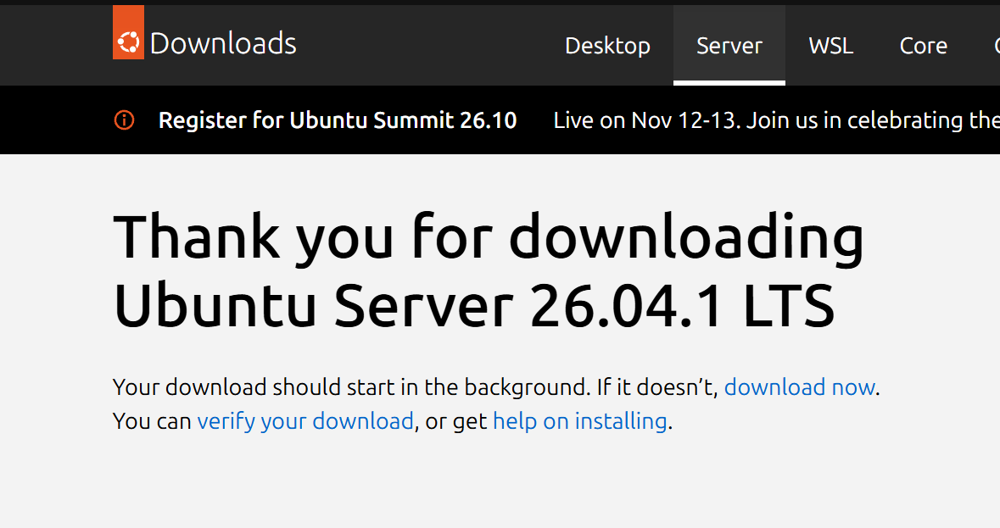

*Ubuntu Server download page consulted during lab preparation.*


*Ubuntu Server installation-option screen.*

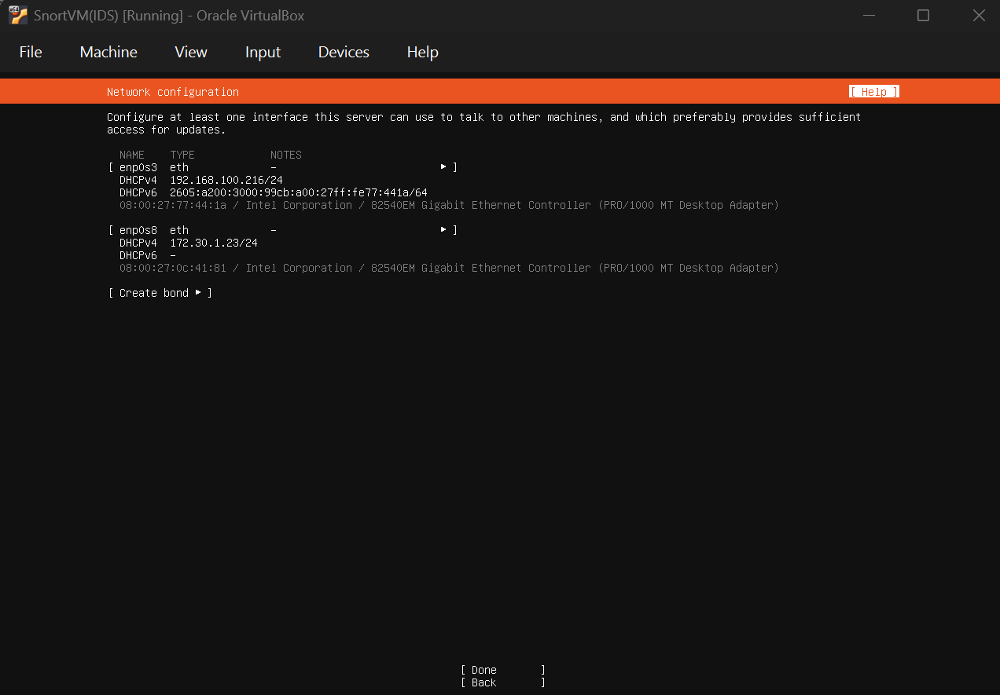

*Ubuntu installer showing available virtual network interfaces.*

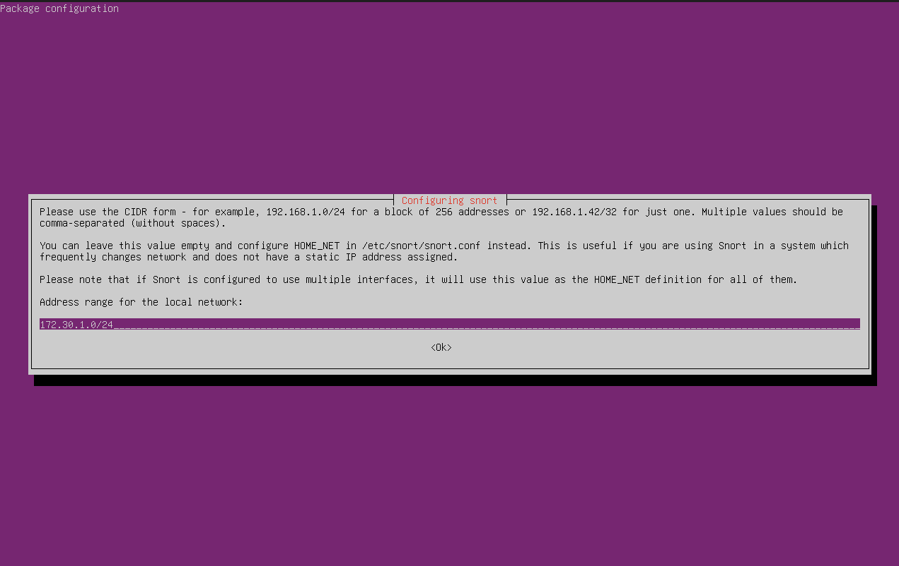

*Ubuntu Server installation/progress screen.*


*Ubuntu Server console following installation.*

**Why this step matters:** The IDS needs an operational Linux host and visibility into the virtual network. The interface later referenced in the Snort command is `enp0s8`; selecting the wrong interface can result in no relevant traffic being observed.

### 2. Confirm connectivity from Kali

From Kali Linux, I generated traffic toward the lab endpoint:

```bash
ping 172.30.1.26
```

`ping` sends ICMP Echo Requests to the destination and reports the replies and round-trip times. The screenshot shows **5 packets transmitted, 5 received, 0% packet loss**. This establishes reachability between the tested systems at that time; it does not prove that every VM was on one network.


*Kali successfully pinging 172.30.1.26 with five replies and zero packet loss.*

### 3. Configure Snort's protected network

Snort reads its settings from `/etc/snort/snort.conf`. I opened the file with GNU nano:

```bash
sudo nano /etc/snort/snort.conf
```

- `sudo`: opens the file with administrator permissions.
- `nano`: a terminal-based text editor.
- `/etc/snort/snort.conf`: Snort's main configuration file in this lab.

The screenshot shows this setting:

```snort
ipvar HOME_NET 172.30.1.0/24
```

`HOME_NET` identifies the subnet being monitored/protected. Custom rules use `$HOME_NET` to avoid hardcoding the subnet repeatedly. The `172.30.1.0/24` prefix contains addresses from `172.30.1.0` through `172.30.1.255` (the usable host addresses normally exclude the network and broadcast addresses).

**Note:** The screenshot also contains other network variables. Their exact values can vary between installations; only the displayed `HOME_NET` setting is presented here as a deliberate configuration choice.

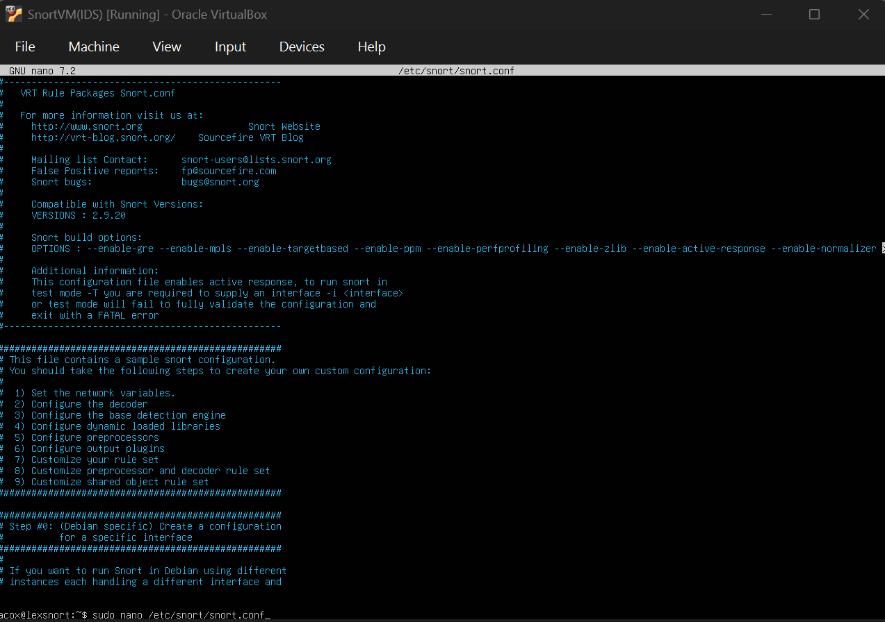

*Editing /etc/snort/snort.conf with GNU nano.*

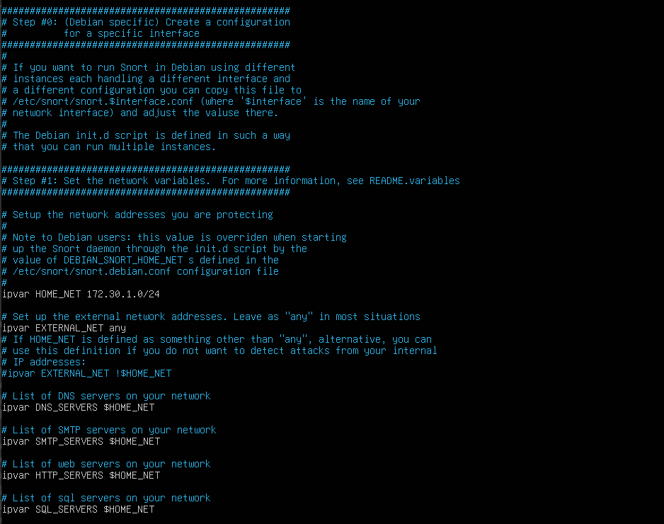

*Snort HOME_NET set to 172.30.1.0/24 in snort.conf.*

### 4. Validate Snort's configuration before monitoring

The lab used the Snort test mode:

```bash
sudo snort -T -i enp0s8 -c /etc/snort/snort.conf
```

| Part | Function |
|---|---|
| `sudo` | Uses the privileges needed for network capture and Snort configuration access. |
| `snort` | Invokes the Snort IDS engine. |
| `-T` | Tests configuration and rules without continuing into live monitoring. |
| `-i enp0s8` | Selects the interface relevant to the lab. |
| `-c /etc/snort/snort.conf` | Loads the specified Snort configuration. |

The console identifies **Snort 2.9.20 GRE (Build 82)** and reports **“Snort successfully validated the configuration!”** This confirms the validated configuration loaded at that stage. It does not, by itself, verify that every later custom rule had already been added.

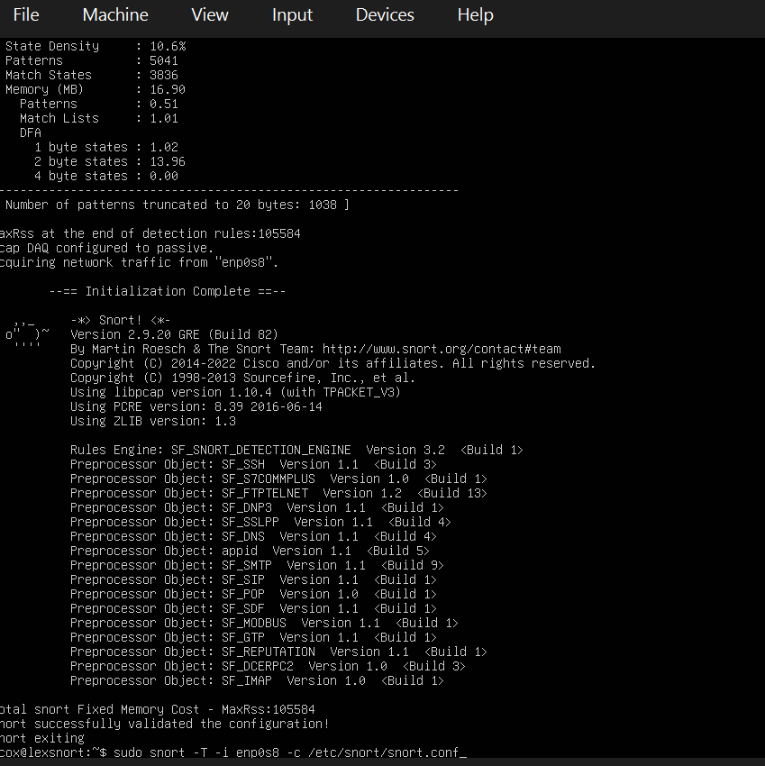

*Snort 2.9.20 output reporting successful configuration validation.*

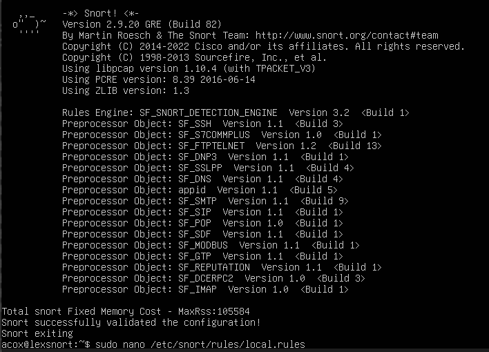

*Snort rule engine/initialization output from the validation workflow.*

### 5. Write the first custom rule — ICMP detection

The custom signatures were stored in:

```text
/etc/snort/rules/local.rules
```

The screenshot shows an initial user-defined ICMP rule:

```snort
alert icmp any any -> $HOME_NET any (msg:"ICMP has been Detected"; sid:1000001; rev:1;)
```

| Rule field | Meaning |
|---|---|
| `alert` | Generates an alert when the rule matches; it is not a drop action. |
| `icmp` | Inspect ICMP packets. |
| `any any` | Any source address / source port placeholder (ICMP has no TCP/UDP ports). |
| `->` | Apply the rule in the source-to-destination direction. |
| `$HOME_NET any` | Destination must be within the configured protected subnet; the port field is `any`. |
| `msg` | Text displayed in Snort's alert. |
| `sid:1000001` | Signature ID used to distinguish this custom rule. |
| `rev:1` | Revision number of the rule. |

This first rule intentionally matches a broad category of ICMP traffic. It is useful for controlled validation but would be noisy in a busy production network.

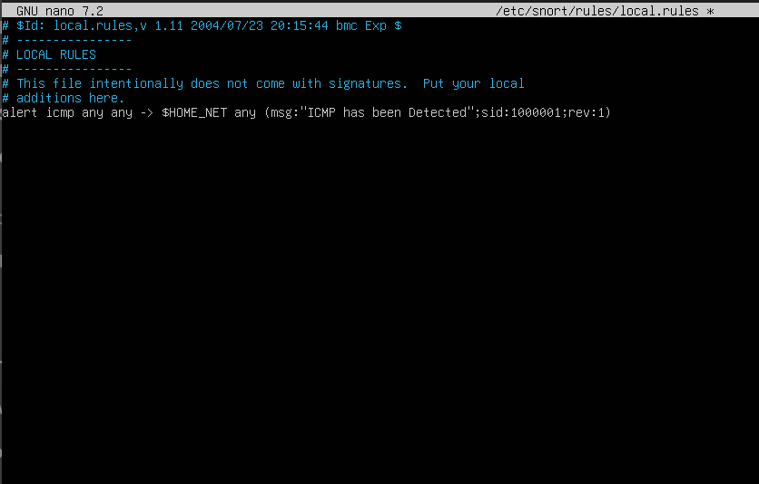

*First custom local.rules signature: ICMP detection, SID 1000001.*

### 6. Run Snort in live alert mode

I started the sensor with:

```bash
sudo snort -q -l /var/log/snort -i enp0s8 -A console -c /etc/snort/snort.conf
```

| Option | Explanation |
|---|---|
| `-q` | Quiet mode, suppressing much of the startup output. |
| `-l /var/log/snort` | Specifies the directory for saved logs. |
| `-i enp0s8` | Captures packets on the selected interface. |
| `-A console` | Prints alerts directly to the terminal. |
| `-c` | Loads Snort's main configuration and referenced rules. |

The first screenshots show live ICMP events while Kali generated test packets. Alert messages include the custom SID and the communication endpoints, demonstrating that the rule was available to Snort during monitoring.

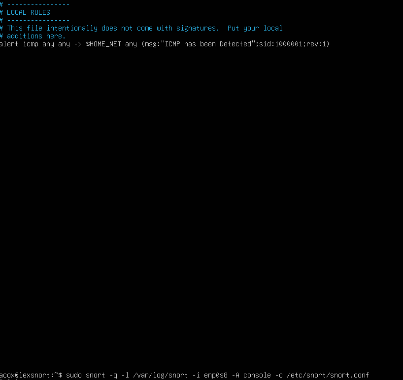

*ICMP rule in local.rules and Snort live-monitoring command visible in terminal.*

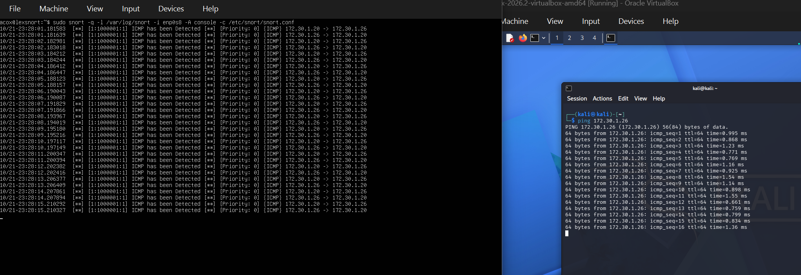

*Snort console monitoring alongside Kali ping traffic.*

### 7. Review stored packets

The original lab also inspected a saved Snort log. A screenshot shows this command being prepared:

```bash
sudo snort -v -r /var/log/snort/snort.log.1792625255 | less
```

- `-v`: print packet details verbosely.
- `-r`: read packets from an existing capture file instead of live traffic.
- `| less`: paginate the output for review.

A separate screenshot shows ICMP **Echo Request (Type 8)** and **Echo Reply (Type 0)** records involving `172.30.1.20` and `172.30.1.26`. Together, these demonstrate basic packet-level inspection after the live test. The saved-log file is not distributed in this repository, so the screenshot is the available evidence.

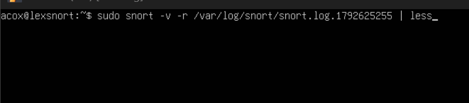

*Command for reading a saved Snort packet log with less.*

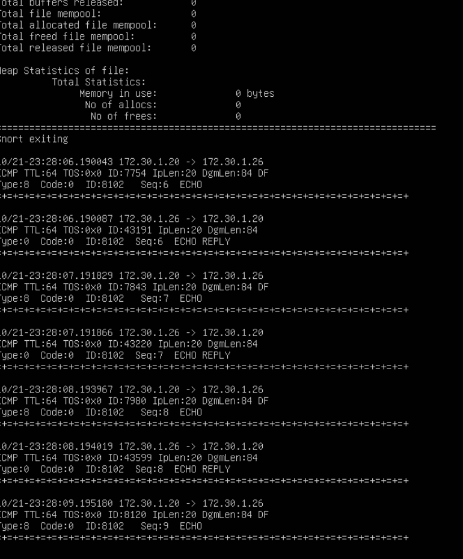

*Saved-log review showing ICMP Echo and Echo Reply packet data.*

### 8. Develop an oversized-ICMP rule and test it

I expanded the local rule set with a second signature:

```snort
alert icmp any any -> $HOME_NET any (msg:"Large ICMP Detected Alex"; dsize:>500; sid:1000002; rev:1;)
```

The new condition, **`dsize:>500`**, requires an ICMP packet payload exceeding 500 bytes. This makes it more selective than the first rule.

Two tests appear in the Kali screenshot:

```bash
ping 172.30.1.26
ping 172.30.1.26 -s 501
```

On Linux, `ping -s 501` requests **501 data bytes** in the ICMP Echo Request; the full ICMP packet is larger once headers are included. This provides a controlled packet size that should satisfy the `dsize` condition. The screenshots show successful echo replies for both standard and larger packets.

Snort's console then displays **`[1:1000002:1] Large ICMP Detected Alex`** alongside the general ICMP rule (`1000001`) and a built-in ICMP signature. This is the strongest direct evidence in the lab that a custom condition was added and exercised.

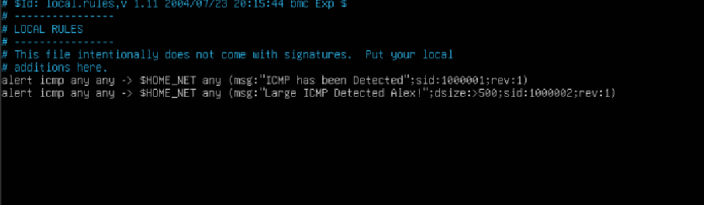

*Custom ICMP and large-payload ICMP rules, SIDs 1000001 and 1000002.*

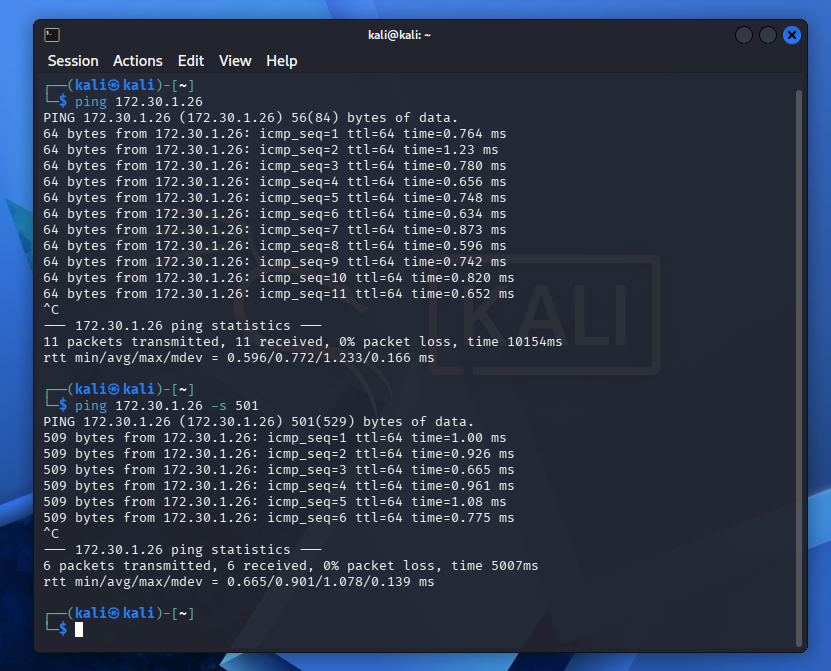

*Standard ping and ping -s 501 tests from Kali.*

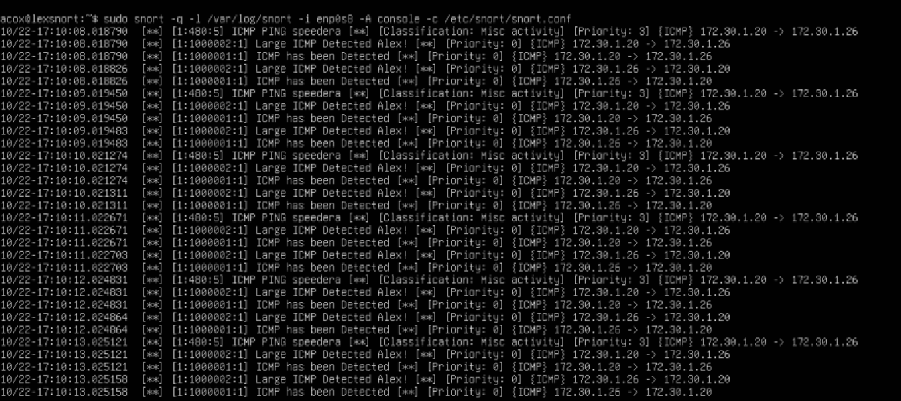

*Snort alerts for standard and large ICMP packets, including the SID 1000002 rule.*

### 9. Extend detection to FTP, SSH and a protected HTTP path

The final `local.rules` screenshot contains **five custom signatures**. I transcribed their logic below for readability; the repo also includes a separate [`rules/local.rules`](rules/local.rules) file.

```snort
alert icmp any any -> $HOME_NET any (msg:"ICMP has been Detected"; sid:1000001; rev:1;)
alert icmp any any -> $HOME_NET any (msg:"Large ICMP Detected Alex"; dsize:>500; sid:1000002; rev:1;)
alert tcp any any -> $HOME_NET 21 (msg:"FTP connection detected"; sid:1000003; rev:1;)
alert tcp any any -> $HOME_NET 22 (msg:"SSH connection detected"; sid:1000004; rev:1;)
alert tcp any any -> $HOME_NET 80 (msg:"Attempt to get into protected page"; content:"GET"; content:"/alexanderadmin.php"; sid:1000005; rev:1;)
```

| SID | Purpose | How it matches | Verified test outcome |
|---|---|---|---|
| `1000001` | ICMP traffic | ICMP packet to `$HOME_NET` | Matching console alerts shown. |
| `1000002` | Larger ICMP payloads | ICMP payload `>500` bytes | `ping -s 501` and matching alerts shown. |
| `1000003` | FTP connections | TCP packets destined for port `21` on `$HOME_NET` | Rule definition shown; no clear matching FTP alert screenshot. |
| `1000004` | SSH connections | TCP packets destined for port `22` on `$HOME_NET` | SSH attempt and matching alerts shown. |
| `1000005` | Protected-path HTTP request | TCP traffic to port `80` containing `GET` and `/alexanderadmin.php` | Rule definition shown; no clear matching HTTP alert screenshot. |

**Detection design caveats:** These are introductory signature examples. A TCP packet to port `21`/`22` is not proof of a successful FTP or SSH login. The HTTP rule uses raw content strings and does not by itself provide robust HTTP transaction parsing, and unencrypted HTTP only is addressed. In production, signatures would need protocol-aware refinement, context and tuning to reduce false positives.

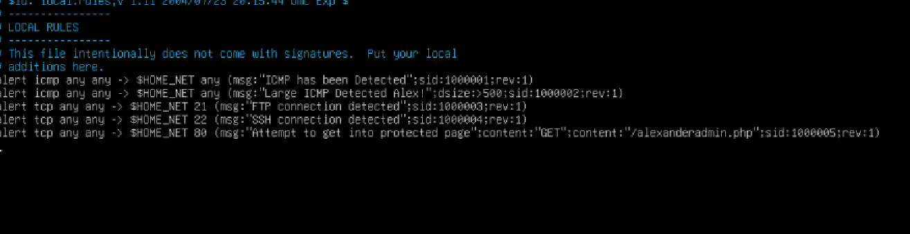

*All five custom local.rules signatures for ICMP, large ICMP, FTP, SSH and a protected HTTP path.*

### 10. Test the SSH detection rule

The Kali screenshot shows this test:

```bash
ssh msfadmin@172.30.1.26
```

The terminal displayed the host-key authenticity prompt, which demonstrates an attempted SSH connection. It does **not** show a completed authenticated login.

Snort subsequently logged multiple alerts with signature **`[1:1000004:1] SSH connection detected`** and traffic directed to `172.30.1.26:22`. This validates that the custom TCP port-22 rule matched the observed traffic.

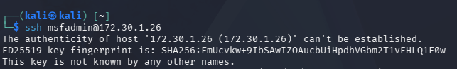

*Kali SSH connection attempt to 172.30.1.26 and initial host-key verification prompt.*

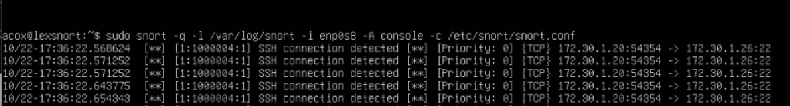

*Snort SSH connection detected events with custom SID 1000004.*

### 11. Run a separate TCP SYN scan and inspect further alerts

Kali performed:

```bash
nmap -sS 172.30.1.26
```

- `nmap`: network scanning tool.
- `-sS`: TCP SYN scan, generally used to infer port state from TCP responses.
- `172.30.1.26`: the lab test endpoint.

**Observed result:** The host was reachable and **`22/tcp open ssh`** appeared in the scan output. A following Snort capture includes additional custom SSH detections and built-in SNMP-related signatures. Since the screenshots do not unambiguously tie every alert to the exact Nmap packet sequence, I have not attributed all of those events directly to the scan.


*Kali nmap -sS against 172.30.1.26 showing 22/tcp open.*

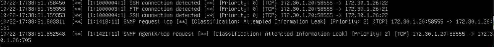

*Follow-up Snort console showing custom SSH events and built-in SNMP-related signatures.*

---

## Results and evidence summary

| Test / configuration | Evidence | What it demonstrates |
|---|---|---|
| Virtual Snort sensor configured | Ubuntu/VirtualBox screens | The test system was provisioned. |
| Snort `HOME_NET` set | `snort.conf` screenshot | The lab subnet was represented in configuration. |
| Snort validation | Snort 2.9.20 output | Configuration passed the recorded test. |
| First custom ICMP signature | `local.rules`, SID `1000001` | Rule creation and alert matching. |
| Large-payload ICMP signature | `local.rules`, `ping -s 501`, SID `1000002` alerts | Threshold-based signature tested against controlled traffic. |
| FTP detection rule | `local.rules`, SID `1000003` | Rule authored, alert activation not independently demonstrated. |
| SSH detection rule | SSH attempt, SID `1000004` alerts | The authored port-22 rule matched TCP activity. |
| Protected HTTP path rule | `local.rules`, SID `1000005` | Rule authored, matching HTTP event not independently demonstrated. |
| Packet review | Snort saved-log screenshot | ICMP Echo/Echo Reply details were inspected. |
| Nmap scan | Kali `-sS` screenshot | Test endpoint had an open SSH service. |

### Lessons learned

1. **Configuration matters:** The correct capture interface and `HOME_NET` scope are prerequisites for meaningful network monitoring.
2. **Custom signatures can be validated:** I wrote a simple ICMP rule, added a payload-size threshold, and checked for matching Snort SIDs in the output.
3. **Port-based rules are broad:** An SSH or FTP port match signals traffic to that service, not a successful compromise.
4. **Detection is not prevention:** This lab records Snort IDS alerts; there is no verified active blocking or firewall enforcement evidence.
5. **Alert context matters:** I compared source/destination addresses, protocol, rule SID and timestamps with the test traffic before interpreting a detection.

## Repository contents

```text
Snort-Intrusion-Detection/
├── README.md
├── SCREENSHOT-GUIDE.md
├── UPLOAD-INSTRUCTIONS.txt
├── rules/
│   └── local.rules
└── screenshots/
    └── 25 source-verified images, ordered by the walkthrough
```

The `SCREENSHOT-GUIDE.md` maps every renamed screenshot to the original embedded image number in the source Word document, so every figure can be checked.

## Scope and safety

This is a controlled educational network-security exercise. Snort 2.9.20 is an older major version; rules and configuration shown here are historical lab evidence, not a turnkey current production deployment. Traffic generation and scanning are described only for systems within the authorized virtual lab. The source images do not show a pfSense-based Snort setup, so the project does not claim one.

## References

- [Snort official website](https://www.snort.org/)
- [Snort rules documentation](https://docs.snort.org/)
- [Nmap reference guide](https://nmap.org/book/man.html)
- [Ubuntu documentation](https://documentation.ubuntu.com/server/)

**Portfolio:** [KerberosAC](https://github.com/KerberosAC) · [LinkedIn](https://www.linkedin.com/in/alexandercox25/)
